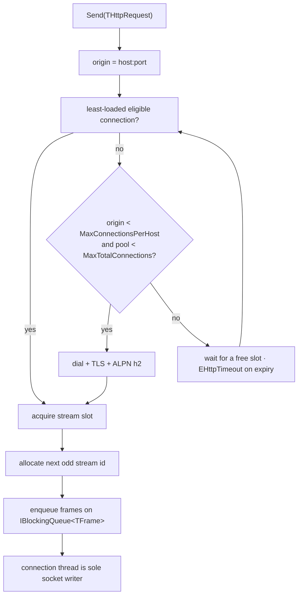

# Client API

## HttpClientFactory

```pascal
type
  THttpClientFactory = record
  private
    FMaxConnectionsPerHost: Integer;
    FMaxTotalConnections: Integer;
    FMaxStreamsPerConnection: Integer;
    FFollowRedirects: Boolean;
    FMaxRedirects: Integer;
    FConnectTimeoutMs: Integer;
    FHeaderTimeoutMs: Integer;
    FIdleTimeoutMs: Integer;
    FProxyHost: string;
    FProxyPort: Word;
    FSocketFactory: IHttp2SocketFactory;   // test seam / custom transport
    FCACertFile: string;                   // trust anchor bundle
    FInsecure: Boolean;                    // skip certificate verification
    FObserver: IHttp2Observer;
    FRequestObservers: TArray<IHttpClientObserver>;
    FLogger: IHttpLogger;
    FHttp1Fallback: Boolean;
    FClearTextPolicy: TClearTextPolicy;
  public
    class function Create: THttpClientFactory; static;
    function WithMaxConnections(const AMax: Integer): THttpClientFactory;
    function WithMaxConnectionsPerHost(const AMax: Integer): THttpClientFactory;
    function WithMaxTotalConnections(const AMax: Integer): THttpClientFactory;
    function WithMaxStreamsPerConnection(const AMax: Integer): THttpClientFactory;
    function WithFollowRedirects(const AFollow: Boolean): THttpClientFactory;
    function WithMaxRedirects(const AMax: Integer): THttpClientFactory;
    function WithProxy(const AHost: string; const APort: Word): THttpClientFactory;
    function WithProxySelector(const ASelector: IProxySelector): THttpClientFactory;
    function WithAllProxy(const AUrl: string): THttpClientFactory;
    function WithProxyEnvironmentVars(const AEnable: Boolean = True): THttpClientFactory;
    function WithNoProxy(const AList: string): THttpClientFactory;
    function WithProxyEnvironmentLookup(const ALookup: TEnvLookup): THttpClientFactory;
    function WithConnectTimeout(const AMs: Integer): THttpClientFactory;
    function WithHeaderTimeout(const AMs: Integer): THttpClientFactory;
    function WithIdleTimeout(const AMs: Integer): THttpClientFactory;
    function WithSocketFactory(const AFactory: IHttp2SocketFactory): THttpClientFactory;
    function WithCACertFile(const AFileName: string): THttpClientFactory;
    function WithInsecureTls(const AInsecure: Boolean = True): THttpClientFactory;
    function WithClientIdentity(const AIdentity: IClientIdentity): THttpClientFactory;
    function WithClientCertificateFiles(const ACertFile, AKeyFile: string;
      const APassphrase: string = ''): THttpClientFactory;
    function WithClientIdentitySelector(
      const ASelector: IClientIdentitySelector): THttpClientFactory;
    function WithProxyClientIdentity(const AIdentity: IClientIdentity): THttpClientFactory;
    function WithHttp1Fallback(const AEnable: Boolean = True): THttpClientFactory;
    function WithClearText(const APolicy: TClearTextPolicy): THttpClientFactory;
    function WithObserver(const AObserver: IHttp2Observer): THttpClientFactory;
    function WithRequestObserver(const AObserver: IHttpClientObserver): THttpClientFactory;
    function WithLogger(const ALogger: IHttpLogger): THttpClientFactory;
    function Build: IHttpClient;
    // read-only accessors: MaxConnections, MaxConnectionsPerHost,
    // MaxTotalConnections, MaxStreamsPerConnection, FollowRedirects,
    // MaxRedirects, ConnectTimeoutMs, HeaderTimeoutMs, IdleTimeoutMs,
    // CACertFile, Http1Fallback, Observer, RequestObservers, Logger
  end;
```

The factory is a **pure value record**: every `WithX` returns a new record
with one field changed, so a stored factory can be reused and forked without
shared mutable state. `Build` allocates the `IHttpClient` and its pool.

Defaults:

| Setting | Default | Meaning |
|---|---|---|
| `MaxConnectionsPerHost` | `4` | concurrent TCP connections to one authority (`host:port`) |
| `MaxTotalConnections` | `32` | concurrent TCP connections across every authority combined |
| `MaxStreamsPerConnection` | `100` | concurrent streams per connection offered to the peer |
| `FollowRedirects` | `True` | automatic redirect handling (see [errors-redirects](errors-redirects.md)) |
| `MaxRedirects` | `10` | redirect chain limit before `EHttpTooManyRedirects` |
| `ConnectTimeoutMs` | `10000` | TCP + TLS handshake deadline |
| `HeaderTimeoutMs` | `30000` | response-header deadline once headers are expected |
| `IdleTimeoutMs` | `60000` | idle connection reap time |
| `Http1Fallback` | `False` | allow HTTP/1.1 when the peer does not offer `h2`; see [fallback](fallback.md) |
| `ClearTextPolicy` | `ctReject` | reject `http` origins; `ctPriorKnowledge`, `ctUpgrade` and `ctHttp1` accept them (`ctHttp1` speaks HTTP/1.1 with no upgrade probe); see [fallback](fallback.md) |

Two connection caps apply, because a pool has two different budgets: a
**per-authority** one (how many TCP connections may serve one `host:port`, a
parallelism/reuse decision) and a **pool-wide** one (how many file descriptors
and TLS states the client may hold in total, a resource decision).
`MaxStreamsPerConnection` is the per-connection request cap and is applied on
top of the peer's `SETTINGS_MAX_CONCURRENT_STREAMS` (whichever is smaller).

RFC 9113 section 9.1 says a client *SHOULD NOT* open more than one HTTP/2
connection to a given host and port, so `MaxConnectionsPerHost = 1` is the
most conformant choice and is what a single-authority client wants. The
default of `4` keeps headroom for a small number of connections to share the
load; raise it only with a measurement. High-concurrency workloads that would
rather open a few connections than expose very wide multiplexing should lower
`MaxStreamsPerConnection` (say to `20`–`50`) and set
`MaxConnectionsPerHost` in the `1`–`4` range, e.g. `WithMaxConnectionsPerHost(2)`
with `WithMaxTotalConnections(128)`.

`WithMaxConnections(max)` is a shorthand: it sets **both** caps to `max`,
which suits a single-authority pool. `WithMaxConnectionsPerHost` and
`WithMaxTotalConnections` set each cap separately; a high-concurrency client
uses them to bound each host tightly while still allowing many hosts.

`WithProxy(host, port)` routes every dial that the no-proxy list does not
exempt through an HTTP `CONNECT` tunnel to `host:port`; the tunnel is
established on the plain socket, so TLS and ALPN still target the origin. A
proxy that refuses the `CONNECT` surfaces as `EHttpConnectionError`; there is
no forwarding mode and no silent direct fallback. See [transport](transport.md).

Three further methods choose the route per request. `WithProxyEnvironmentVars`
reads `http_proxy`, `https_proxy`, `all_proxy` and `no_proxy` when the client
is built and is off by default. `WithAllProxy(url)` is the manual counterpart
of `all_proxy`: one proxy URL, including `https://` and `socks5://` forms with
credentials, for every scheme without a more specific proxy. `WithNoProxy(list)` adds hosts that always connect directly
and accepts the `no_proxy` grammar. `WithProxySelector(selector)` installs an
`IProxySelector`, whose `SelectProxy(uri)` returns the proxy for a request or
`nil` for a direct connection; a selector overrides every other proxy setting.
Precedence, grammar, pooling and error behaviour are described in [proxy](proxy.md).

The three timeout setters take a single value each — `WithConnectTimeout`,
`WithHeaderTimeout`, `WithIdleTimeout` — and override the matching default
below for every request on the built client. See [errors-redirects](errors-redirects.md).

`WithSocketFactory` replaces the transport wholesale. It is the seam the
test suite uses (`IHttp2SocketFactory` with an in-memory socket) and the
hook for a caller who must supply their own TLS stack. `WithCACertFile`
points certificate verification at a specific trust bundle;
`WithInsecureTls` disables verification (test/development only, never a
default). `WithClientIdentity` presents a client certificate on every TLS
connection to an origin (mutual TLS), and `WithClientCertificateFiles` loads
one from PEM files; `Build` raises `EHttpTlsConfigError` for an identity that
cannot be used, and a server that refuses the certificate raises
`EHttpTlsClientAuthError`. `WithClientIdentitySelector` asks an
`IClientIdentitySelector` for the identity of each new TLS connection (once per
dial, outside the pool lock, with an expired answer refused before dialling),
which gives a different identity per origin and certificate rotation; with it
installed the pool key carries the identity fingerprint, while
`MaxConnectionsPerHost` still counts the origin across identities and an idle
connection of another identity is closed to make room at a cap.
An identity or selector with an injected `WithSocketFactory` that cannot
present identities (no `IIdentitySocketFactory`) raises `EHttpTlsConfigError`
at `Build`, or at `Send` for a request identity. `WithProxyClientIdentity` answers an `https://` proxy that
requires a client certificate, and the identity goes to that proxy only; the
origin identity goes to the origin on every route. A request can carry its own
origin identity with `THttpRequest.WithClientIdentity` (and
`IWebSocketRequest.WithClientIdentity`), which wins over the selector and the
fixed identity. See [mtls](mtls.md). `WithObserver` installs an `IHttp2Observer` for connection,
stream, and frame-level events — see [testing-observability](testing-observability.md).

`WithRequestObserver` installs an `IHttpClientObserver`, the request-level
seam above `IHttp2Observer`. Each call adds an observer: start callbacks run in
registration order and end callbacks in reverse. An observer is told when each
attempt (a request, a redirect hop, a transparent retry) starts, receives the
response headers, a redirect or a retry, and is told once when the attempt
ends, which is when the body finishes or the response is released. It may
inject headers into each attempt through `THttpAttempt.Headers`; the request
the caller built is never modified. `THttpRequest.WithContext` attaches an
opaque object that reaches the observer in `THttpAttempt.Context` on every
attempt. A client with no request observer pays one nil check per `Send`.
`WithLogger` installs an `IHttpLogger`, which receives a warning when an
observer raises (the exception is otherwise swallowed). The full contract is
in [request-observability](request-observability.md).

### TLS and trust

| Setting | Default | Meaning |
|---|---|---|
| `SocketFactory` | `TDefaultSocketFactory` | the socket/TLS implementation; overridable for tests |
| `CACertFile` | empty (system store) | PEM trust anchor bundle used to verify the peer |
| `Insecure` | `False` | when true, skip certificate and hostname verification |

`Insecure` is exposed for tests and local servers only. It is not set by
any example and is not reachable through the plain `Create` defaults.

Fluent use:

```pascal
var
  Client: IHttpClient;
begin
  Client := THttpClientFactory.Create
    .WithMaxConnectionsPerHost(2)
    .WithMaxTotalConnections(8)
    .WithMaxStreamsPerConnection(50)
    .WithFollowRedirects(False)
    .Build;
end;
```

## HttpClient

```pascal
type
  IHttpClient = interface
  ['{6B1C2D3E-4F50-4A61-9C72-000000000001}']
    function Send(const ARequest: THttpRequest): IHttpResponse; overload;
    function Send(const ARequest: IWebSocketRequest): IWebSocket; overload;
    procedure Close;
  end;
```

`Send` **blocks until response status and headers are available**, then
returns an `IHttpResponse` whose body can be streamed or drained (see
[messages](messages.md)). It does not block until the body is complete. `Send` is
thread-safe and may be called concurrently from many threads; each call
acquires its own stream lease.

The second `Send` opens a WebSocket (see [websocket](websocket.md)): it dials a dedicated
HTTP/1.1 connection, runs the upgrade handshake and returns an `IWebSocket`
whose listener callbacks run on its own reader thread. That connection is not
pooled. A class that implements `IHttpClient` itself has to provide both
overloads.

`Close` stops accepting new leases, gracefully closes open connections
(GOAWAY, see [transport](transport.md)), and releases the pool. Outstanding
`IHttpResponse` bodies remain readable until they complete or the caller
releases them.

### Pool statistics

`THttpClient.PoolStats` returns a `TPoolStats` snapshot of the connection
pool: total, idle and active-stream counts, the callers parked waiting for a
slot, and per origin (the key includes the proxy route) the same counts plus a
`TConnectionStats` for each connection with its protocol, state, age, idle
time and the peer's settings. The record types and the field list are in
[request-observability](request-observability.md#pull-based-pool-statistics).

The counts are the ones the pool's own caps use: `Connections` is what
`MaxTotalConnections` bounds, `ActiveStreams` is what
`MaxStreamsPerConnection` and the peer's `SETTINGS_MAX_CONCURRENT_STREAMS`
bound, and `PendingAcquires` is the number of `Send` calls waiting for a slot.
The snapshot is copied under the pool lock and returned by value, so it is
consistent and points at nothing in the pool. On a closed client it is all
zeros. It is safe from any thread.

### Lease acquisition

`Send` performs these steps under the pool's `TCriticalSection`:

1. Compute `Origin` from the request URL (`host:port`; default port by
   scheme). This becomes the `:authority` pseudo-header.
2. Look up the connection list for `Origin` and choose the **least-loaded
   eligible** connection — one that is open (or opening) and whose active
   stream count is below both `MaxStreamsPerConnection` and the peer's
   advertised `SETTINGS_MAX_CONCURRENT_STREAMS`.
3. If none is eligible and the origin count is below
   `MaxConnectionsPerHost` and the pool count is below `MaxTotalConnections`,
   **open a new connection** for `Origin` and use it.
4. Otherwise **wait** for a slot to free (bounded by the configured
   timeouts, else `EHttpTimeout`).
5. Allocate the next odd stream id on the chosen connection, build a
   `TStreamLease`, and enqueue the request frames on the connection's
   `TBlockingQueue<TFrame>`.



The connection thread is the **sole writer** to the socket: callers never
touch the socket directly, they only enqueue frames. This keeps
HPACK encoder state and flow-control accounting single-threaded on the
write side. See [transport](transport.md) for the queue design and [protocol](protocol.md) for
flow control.
