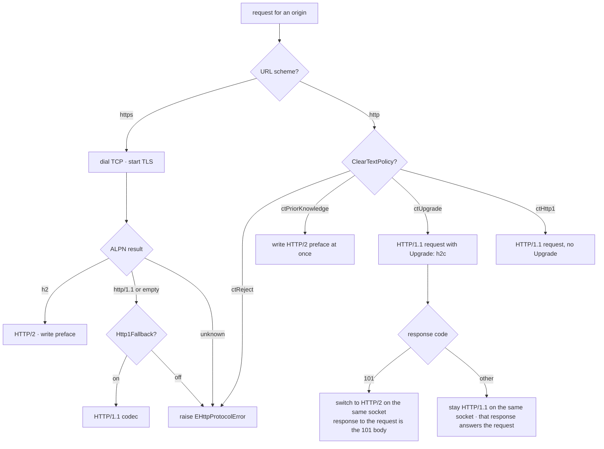

# Cleartext h2c and HTTP/1.1 Fallback

This note describes cleartext HTTP/2 (`h2c`) and HTTP/1.1 fallback, which
the client supports when the caller enables them.

## Scope

The client supports five protocol modes. The client selects one mode for
each origin.

| Mode | URL scheme | Transport | How the client selects it |
| --- | --- | --- | --- |
| `h2` over TLS | `https` | TCP + TLS | ALPN selects `h2` |
| `h2c` prior knowledge | `http` | TCP, cleartext | The caller sets the policy |
| `h2c` upgrade | `http` | TCP, cleartext | The client sends an `Upgrade: h2c` request |
| HTTP/1.1 | `https` or `http` | TLS or cleartext | ALPN selects `http/1.1`, or the upgrade fails |
| HTTP/1.1, no probe | `http` | TCP, cleartext | The caller sets the policy |

The default stays strict. The client uses `h2` over TLS only. Cleartext and
HTTP/1.1 fallback are off until the caller enables them. See "Factory
surface".

All five modes are covered by tests and interop cases A.10–A.13; see
"Implementation status".

WebSocket connections ([websocket](websocket.md)) sit outside these modes. They always
speak HTTP/1.1 for the opening handshake and take no part in the fallback and
cleartext switches: a `ws://` URL connects under the default cleartext policy.

## Terms

- **Origin.** The form `scheme://host:port`. The default port follows the
  scheme. The origin is the connection pool key. See [architecture](architecture.md).
- **Strict mode.** The default. The client requires `h2` over TLS.
- **Fallback.** The client accepts HTTP/1.1 when the peer does not offer
  `h2`.
- **h2c prior knowledge.** The client sends the HTTP/2 connection preface at
  once on a cleartext TCP connection. The client does no negotiation.
- **HTTP/1.1 without a probe.** The client speaks HTTP/1.1 on a cleartext
  connection from the first byte. It sends no `Upgrade` header and never tries
  HTTP/2 on that connection. This suits a server that only speaks HTTP/1.1,
  where an upgrade can never succeed.
- **h2c upgrade.** The client sends one HTTP/1.1 request. That request
  carries an `Upgrade: h2c` header. The peer answers with `101 Switching
  Protocols`. Then both peers use HTTP/2 on the same connection.

## Negotiation

The client follows one algorithm for each request. The pool caches the
result for the origin. See [client-api](client-api.md) for lease acquisition.

### `https` origins

1. Dial TCP. Start TLS.
2. Offer the ALPN list. Use `h2` and `http/1.1` when fallback is on. Use
   `h2` alone when fallback is off.
3. Read the ALPN result.
4. If ALPN is `h2`, use HTTP/2. Write the connection preface. Continue with
   [transport](transport.md).
5. If ALPN is `http/1.1` and fallback is on, use the HTTP/1.1 codec.
6. If ALPN is empty and fallback is on, use HTTP/1.1. RFC 7301 says that an
   empty ALPN result means HTTP/1.1.
7. If ALPN is `http/1.1` or empty and fallback is off, raise
   `EHttpProtocolError`. The message names the selected protocol. This
   matches test A.9.
8. If ALPN names an unknown protocol, raise `EHttpProtocolError`.

### `http` origins

1. Dial TCP. Do not start TLS.
2. Read the cleartext policy.
3. If the policy is **reject**, raise `EHttpProtocolError`. The default
   policy is reject.
4. If the policy is **prior knowledge**, write the HTTP/2 connection
   preface. Use HTTP/2. Send no `Upgrade` header.
5. If the policy is **upgrade**, send the h2c upgrade procedure. See the
   next section.
6. If the policy is **HTTP/1.1**, use the HTTP/1.1 codec on the connection.
   Send no `Upgrade` header.



## h2c upgrade procedure

The client does these steps one time for each connection:

1. Build the request as an HTTP/1.1 request.
2. Add the header `Upgrade: h2c`.
3. Add the header `HTTP2-Settings: <value>`. The value is the base64url
   encoding of the SETTINGS payload, with no padding. See [protocol](protocol.md).
4. Add the header `Connection: Upgrade, HTTP2-Settings`.
5. Send the request. Wait for the response.
6. If the response code is `101`, switch to HTTP/2. Write the connection
   preface. The `101` response is the response to the request.
7. If the upgrade fails, keep the HTTP/1.1 connection. Use the received
   response as the response to the request. The HTTP/1.1 codec then handles
   all later requests on that connection.

The upgrade adds one round trip. Prior knowledge does not. The client uses
prior knowledge only when the caller sets that policy.

### The request is sent once

The upgrade request is a complete HTTP/1.1 request. It carries the caller's
method, target, headers, and three extra headers: `Upgrade`, `Connection`, and
`HTTP2-Settings`. A server that does not upgrade processes it like any other
request and answers it. That answer is the response to the caller's request.
The client reads it from the same socket and does not send the request again.

The rule exists because sending a request twice repeats its effects. A bodyless
`POST`, `PUT`, or `DELETE` can change state on the server, and a retry would
change it twice. The same rule explains why a request with a body does not use
the upgrade at all: the client would have to send the body in the probe and
again over HTTP/2. A request with a body goes over plain HTTP/1.1.

The connection that carried a declined upgrade stays in the pool. It serves
later requests to the same origin as an ordinary HTTP/1.1 connection, until
the server closes it or a response carries `Connection: close`. The next
connection to that origin starts with a new upgrade request.

The client re-sends a request in one other case: the peer refused the stream
or sent `GOAWAY` for it, so the request was never processed, and the method is
idempotent (see [transport](transport.md)).


Rule: the client does not send a later SETTINGS frame that conflicts with
the `HTTP2-Settings` value. The client applies the `HTTP2-Settings` value as
its first SETTINGS frame.

## HTTP/1.1 codec

The HTTP/1.1 codec is small. It is not a general HTTP/1.1 client. It has
this scope:

- Request line: `METHOD SP request-target SP HTTP/1.1 CRLF`.
- Headers: one `Host` header is mandatory. Header names are
  case-insensitive on the wire.
- Header-size limit: the request head, the response head, and accumulated
  chunked trailers are each bounded by `cHttp1MaxHeaderBytes = 64 * 1024`;
  exceeding it raises `EHttpProtocolError`
  (`ecProtocolError`).
- Body: `Content-Length` or `Transfer-Encoding: chunked`.
- Response: status line, headers, and body. The body uses
  `Content-Length`, chunked coding, or connection close.
- Connection reuse: `keep-alive` is the default in HTTP/1.1. The codec takes
  the bytes that have arrived rather than waiting for a full read buffer, so
  a response on a connection the server keeps open is delivered at once. A
  transport signals this through `IPartialReader`.
- The codec does not do request pipelining.

HTTP/1.1 has no multiplexing. One connection carries one request at a time.
For HTTP/1.1 origins the client sets the effective stream limit to 1. The
pool opens more connections when it needs more concurrency, bounded by
`MaxConnectionsPerHost` and `MaxTotalConnections` (see [client-api](client-api.md)).

The codec reuses the public surface. `IHttpClient.Send` and
`IHttpResponse` do not change. Redirects, timeouts, cancellation, and the
observer apply to HTTP/1.1 in the same way. See [errors-redirects](errors-redirects.md) and
[testing-observability](testing-observability.md).

## Factory surface

The factory is a pure value record. Each method returns a new record.
See [client-api](client-api.md).

```pascal
type
  /// how the client treats a cleartext ("http") origin
  TClearTextPolicy = (
    ctReject,           // default: raise EHttpProtocolError
    ctPriorKnowledge,   // send the HTTP/2 preface at once
    ctUpgrade,          // send an HTTP/1.1 Upgrade: h2c request
    ctHttp1             // speak HTTP/1.1 with no Upgrade request
  );

  THttpClientFactory = record
  private
    // ... other fields ...
    FHttp1Fallback: Boolean;
    FClearTextPolicy: TClearTextPolicy;
  public
    // ... other methods ...

    /// allow HTTP/1.1 when the peer does not offer h2 (https origins)
    function WithHttp1Fallback(const AEnable: Boolean): THttpClientFactory;

    /// set the policy for cleartext "http" origins
    function WithClearText(const APolicy: TClearTextPolicy): THttpClientFactory;
  end;
```

Defaults:

| Setting | Default | Meaning |
| --- | --- | --- |
| `Http1Fallback` | `False` | the client requires `h2` |
| `ClearTextPolicy` | `ctReject` | the client rejects `http` origins |

`ctHttp1` is the policy for a cleartext server that only speaks HTTP/1.1, such
as a local development server or a model runtime. `ctUpgrade` suits a server
that may or may not accept `h2c`. `ctPriorKnowledge` suits a server known to
speak `h2c`.

## Pool keys

The pool key is the origin, and the origin includes the scheme. The client
does not mix a TLS connection with a cleartext connection. The client does
not mix an HTTP/2 connection with an HTTP/1.1 connection. [transport](transport.md) holds
the pool rules.

## Errors

The client uses the existing exception hierarchy. See [errors-redirects](errors-redirects.md).

| Condition | Exception |
| --- | --- |
| Fallback is off and ALPN is not `h2` | `EHttpProtocolError` |
| Cleartext policy is `ctReject` and the scheme is `http` | `EHttpProtocolError` |
| The `101` response is malformed | `EHttpProtocolError` |
| A transport failure on a cleartext connection | `EHttpConnectionError` |
| An HTTP/1.1 parse failure | `EHttpProtocolError` |
| A response that exceeds a deadline | `EHttpTimeout` |

An HTTP/1.1 status code is not an error. The client returns it in
`IHttpResponse.StatusCode`, in the same way as HTTP/2.

## Security

Cleartext HTTP/2 and HTTP/1.1 give no confidentiality and no integrity.
Anyone on the network path can read and change the traffic.

Rules:

1. The default rejects all cleartext requests. The caller opts in.
2. The client sends a request that carries a secret over cleartext only when
   the caller set the cleartext policy on purpose.
3. The client does not fall back from `h2` to HTTP/1.1 without the caller's
   consent. A silent fallback can hide a downgrade attack.

The observer has no cleartext-warning event, so a cleartext request produces
no warning; see "Known gaps".

`ctHttp1` is a cleartext policy like the other two. It gives no
confidentiality and no integrity, and the caller opts in to it on purpose.

## Implementation status

The table maps each area to its code and acceptance check:

| Area | Where | Acceptance |
| --- | --- | --- |
| `TClearTextPolicy` + factory methods | `src/Http2.Tls.pas`, `src/Http2.Client.pas` | defaults stay strict (`ctReject`, `Http1Fallback=False`) |
| h2c prior knowledge | `src/Http2.Client.pas` (`TConnectionPool.TryH2cUpgrade` path, preface at once) | a GET against `nghttpd --no-tls` succeeds (A.10) |
| h2c upgrade | `src/Http2.Client.pas` (`AcquireUpgraded`, `BuildH2cUpgradeRequest`, `Http2SettingsBase64Url`) | a GET returns `101` then uses HTTP/2 (A.11) |
| declined upgrade | `src/Http2.Client.pas` (`TConnectionPool.OpenForTxn`, `THttp1PooledConnection.Resume`), `src/Http2.Http1.pas` (`ResumeResponse`) | the request reaches the server once and the connection serves the next request (`Http2.ClearText.Test`, `make validate-cleartext`) |
| HTTP/1.1 without a probe | `src/Http2.Tls.pas` (`ctHttp1`), `src/Http2.Client.pas` | no `Upgrade` or `HTTP2-Settings` byte on the wire (`Http2.ClearText.Test`, `make validate-cleartext`) |
| HTTP/1.1 codec | `src/Http2.Http1.pas` (`THttp1Connection`) | GET and POST against a plain HTTP/1.1 server succeed (A.12) |
| ALPN fallback | `src/Http2.Http1.pas` + transport selection in `Http2.Client` | an `http/1.1`-only TLS server responds when fallback is on |
| pool keys and limits | `TConnectionPool` selection | stream limit is 1 for HTTP/1.1; origins keep scheme apart |
| interop A.10–A.13 | `test/h2probe.pas`, `tools/validate/interop.sh` | part of the green interop gate |

The `http2/http2-test` suite speaks draft-09 plaintext `h2c`; the prior
knowledge path gives that suite a code path to exercise.

## Validation

Four interop cases live in the probe (`test/h2probe.pas`) and
`tools/validate/interop.sh`:

| ID | Case | Pass condition |
| --- | --- | --- |
| A.10 | h2c prior knowledge | a GET against `nghttpd --no-tls` returns `200` |
| A.11 | h2c upgrade | `Upgrade: h2c` → `101`, then the response body arrives over HTTP/2 |
| A.12 | HTTP/1.1 fallback | a GET against an HTTP/1.1 server returns `200` |
| A.13 | strict mode | a cleartext request raises `EHttpProtocolError` |

The live cleartext gate (`make validate-cleartext`) is separate from the
interop table. It runs `GET`, `POST`, `DELETE` and `HEAD` without a body under
`ctUpgrade` and `ctHttp1` against `tools/validate/h1_counter_server.py`, an
HTTP/1.1-only server that logs each request it receives. Every request appears
in the log once. Under `ctHttp1` none carries an `Upgrade` header; under
`ctUpgrade` each carries the probe once.

Result: `interop: PASS=13 FAIL=0 SKIP=1` → `interop gate GREEN`
(see [validation](../verification/validation.md)).

## Known gaps

1. The observer has no cleartext-warning event, so a cleartext request is
   silent. See [testing-observability](testing-observability.md) and [open-questions](open-questions.md).
