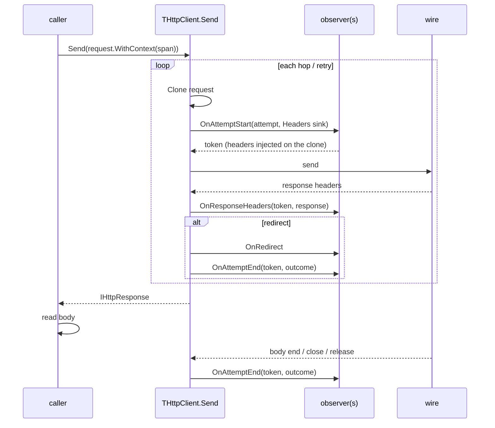

# Request Observability

A generic seam for a consumer to **inject** trace context into outgoing
requests and to **observe** each request for tracing, metrics and logging.
The core knows nothing of OpenTelemetry (or any other system): it exposes
neutral hooks and the facts an adapter needs, and an adapter outside the core
turns them into spans, instruments and log lines.

[`IHttp2Observer`](testing-observability.md) stays as it is. It is the
transport-level seam (connections, streams, frames) and has no request
context. This note adds the request-level seam above it.

## Goals

- Add arbitrary headers to every attempt (`traceparent`, `tracestate`,
  `baggage`, correlation ids) with a fresh value per attempt.
- Report the start, the response headers and the end of every attempt, with
  status, error, byte counts and timings.
- Cover plain requests, Server-Sent Events streams and WebSockets with one
  vocabulary.
- Give enough per-message timing to measure time to first token, inter-event
  latency and throughput of a streaming endpoint, measured at the wire and
  not at the consumer.
- Cost nothing for a client with no observer installed, and little for one
  that wants aggregates only.

## Non-goals

- No OpenTelemetry (or Prometheus, or logging framework) dependency in the
  core. An adapter lives in `examples/` or a sibling package.
- No parsing of response payloads. An adapter that wants token counts from an
  LLM stream reads them from the event the library hands it.
- No sampling, batching, export or retention. Those belong to the adapter.
- No change to the wire behaviour of a client with no observer.

## Vocabulary

**Attempt.** One HTTP exchange on the wire, or one WebSocket session. A
redirect hop is an attempt. A transparent retry after `REFUSED_STREAM` is an
attempt. An SSE reconnect is an attempt. This matches the OpenTelemetry
convention that each HTTP try is its own client span.

**Kind.** `akRequest` (a plain request), `akSse` (a request built by
`SseRequest`) or `akWebSocket`.

**Context.** An opaque `IInterface` the caller attaches to a request with
`WithContext`. The library never inspects it; it hands it back in
`THttpAttempt.Context` so an adapter can find the parent span without a
thread-local. A thread-local remains the adapter's own choice.

## Public surface

### Request context

```pascal
THttpRequest.WithContext(const AContext: IInterface): THttpRequest;
IWebSocketRequest.WithContext(const AContext: IInterface): IWebSocketRequest;
```

The context survives `Clone`, `WithUrl`, `DropBody` and `WithMethodToken`, so
it reaches every redirect hop and every SSE reconnect.

### Header injection

```pascal
IHeaderSink = interface
  /// replace every value of AName with AValue
  procedure SetValue(const AName, AValue: string);
  /// the first value of AName, or '' (a prior observer may have set it)
  function GetFirst(const AName: string): string;
end;
```

The sink writes to the attempt's own copy of the headers. `SetValue` is the
only mutator: `THttpRequest.WithHeader` appends, so injecting `traceparent`
with it would duplicate the header when a caller had already set one. The
same sink serves HTTP and WebSocket handshake headers, so one observer works
for all three kinds. A WebSocket handshake rejects the headers it owns
(`sec-websocket-*`, `upgrade`, `connection`, `host`) with
`EHttpWebSocketError`; the sink applies the same rule.

### Attempt and outcome

```pascal
TAttemptKind = (akRequest, akSse, akWebSocket);

THttpAttempt = record
  Kind: TAttemptKind;
  Method, Url, Host: string;
  Port: Word;
  /// 0 for the first request, +1 per redirect followed
  Hop: Integer;
  /// transparent retries already made on this hop
  Retry: Integer;
  /// SSE: an id the library generates for each `TSseReconnectLoop` and shares
  /// by every attempt of that loop (0 for any other attempt), and the
  /// reconnect count (0 for the first connection)
  StreamId: Int64;
  Reconnect: Integer;
  Context: IInterface;
  Headers: IHeaderSink;
end;

TCloseInitiator = (ciNone, ciLocal, ciRemote, ciAbort, ciError);

THttpOutcome = record
  /// 0 when the attempt failed before response headers
  StatusCode: LongInt;
  Protocol: TNegotiatedProtocol;
  ConnectionReused: Boolean;
  Error: Exception;        // borrowed; nil on success; do not free
  Cancelled: Boolean;
  /// the attempt ended because the response or socket was released without
  /// being read to its end
  Abandoned: Boolean;
  BytesOut, BytesIn: Int64;
  /// microseconds from the start of the attempt (monotonic clock)
  RequestSentUs: Int64;    // last byte of the request written
  HeadersUs: Int64;        // response headers received; 0 if never
  FirstMessageUs: Int64;   // first body chunk / SSE event / WS message; 0 if none
  LastMessageUs: Int64;
  EndUs: Int64;
  MessagesIn, MessagesOut: Int64;
  /// gaps between consecutive inbound messages
  MaxGapUs, SumGapUs: Int64;
  /// akWebSocket only
  Subprotocol: string;
  CloseCode: Integer;
  CloseReason: string;
  ClosedBy: TCloseInitiator;
end;
```

For an SSE stream a "message" is an event; for a plain response it is a body
chunk; for a WebSocket it is a data message (ping and pong are counted
separately by the per-message callback and not in `MessagesIn`).

### The request observer

```pascal
IHttpClientObserver = interface
  /// before the attempt is sent. May inject headers through A.Headers.
  /// The returned token is passed to every later callback of this attempt.
  function OnAttemptStart(const A: THttpAttempt): IInterface;
  /// response headers received (status 101 for a WebSocket)
  procedure OnResponseHeaders(const AToken: IInterface;
    const AResponse: IHttpResponse);
  /// a redirect is about to be followed (AToken belongs to the finished hop)
  procedure OnRedirect(const AToken: IInterface; const AFromUrl, AToUrl: string;
    const AStatus: LongInt);
  /// a transparent retry is about to be made
  procedure OnRetry(const AToken: IInterface; const AReason: string);
  /// the attempt is over; fires exactly once per OnAttemptStart
  procedure OnAttemptEnd(const AToken: IInterface; const O: THttpOutcome);
end;
```

`OnAttemptEnd` fires **exactly once**, after finalization (see
[Attempt end](#attempt-end)).

### Per-message observation

Aggregates in `THttpOutcome` are always collected. Per-message callbacks are
opt-in per attempt:

```pascal
TMessageKind = (mkSseEvent, mkWsText, mkWsBinary, mkWsPing, mkWsPong, mkWsClose);
TMessageKinds = set of TMessageKind;
TDirection = (mdIn, mdOut);

TMessageInfo = record
  Kind: TMessageKind;
  Direction: TDirection;
  Index: Int64;          // 0-based, per direction
  Size: Integer;         // payload bytes
  ArrivedUs: Int64;      // from the start of the attempt, at the wire
  SinceLastUs: Int64;    // since the previous message in this direction; 0 for the first
  EventType, EventId: string;  // mkSseEvent only
  Sse: PSseEvent;        // mkSseEvent only; valid only during the callback
end;

IHttpMessageObserver = interface
  /// asked once per attempt; an empty set costs nothing for that attempt
  function WantsMessages(const A: THttpAttempt): TMessageKinds;
  procedure OnMessage(const AToken: IInterface; const M: TMessageInfo);
end;
```

An observer implements `IHttpMessageObserver` in addition to
`IHttpClientObserver`; the library discovers it with `Supports`, so an
ordinary observer pays nothing. Nothing is on by default: a WebSocket reports
counters only, and SSE reports per-event callbacks only when the observer's
`WantsMessages` returns `[mkSseEvent]`.

`OnMessage` runs inline on the thread that finishes reading the message (the
caller's thread for SSE, the reader thread for WebSocket). It must be fast.

### Installing observers

```pascal
THttpClientFactory.WithRequestObserver(const AObserver: IHttpClientObserver): THttpClientFactory;
TCompositeObserver = class(TInterfacedObject, IHttpClientObserver, IHttpMessageObserver)
```

`WithRequestObserver` accumulates: each call adds an observer. Start callbacks
run in registration order and end callbacks in reverse, so the observer
registered first wraps the rest (a tracing observer registered first sees
every header the later ones inject). `TCompositeObserver` is the same
behaviour as a reusable class.

### Pull-based pool statistics

```pascal
TConnectionStats = record
  Protocol: TNegotiatedProtocol;
  State: TConnectionState;       // open, going away, closed
  AgeMs, IdleMs: Int64;
  ActiveStreams: Integer;
  /// the peer's settings; 0 for HTTP/1.1
  PeerMaxConcurrentStreams: LongWord;
  PeerInitialWindowSize: LongWord;
  PeerMaxFrameSize: LongWord;
end;

TOriginStats = record
  Origin: string;                // includes the proxy route
  Connections, IdleConnections, ActiveStreams, PendingAcquires: Integer;
  Details: TArray<TConnectionStats>;
end;

TPoolStats = record
  Connections, IdleConnections, ActiveStreams, PendingAcquires: Integer;
  PerOrigin: TArray<TOriginStats>;
end;

THttpClient.PoolStats: TPoolStats;
```

A snapshot taken under the pool lock and copied out, so nothing in it points
at pool state. Gauges are polled by the adapter (an OpenTelemetry
asynchronous gauge, a Prometheus collector). The library pushes no gauge
events. The per-connection detail serves diagnosis: connection age and idle
time show churn, and the peer settings show why streams queue.

### Library diagnostics

```pascal
TLogLevel = (llDebug, llInfo, llWarn, llError);
IHttpLogger = interface
  procedure Log(const ALevel: TLogLevel; const AMessage: string);
end;
THttpClientFactory.WithLogger(const ALogger: IHttpLogger): THttpClientFactory;
```

Only for events that are not request events: an observer that raised, a
cleartext origin (closing the open item in
[open-questions](open-questions.md)), a protocol fallback. Request logging is
an adapter built on `IHttpClientObserver`.

## Lifecycle



For a redirect, `OnAttemptEnd` for the finished hop fires before the next
hop's `OnAttemptStart`, and its body (which the client discards) is complete
by then. For the final hop it fires when the body ends.

### Per hop

`THttpClient.Send` loops over hops and retries and calls `SendOnce` for each.
The attempt starts and ends around `SendOnce`, so `Hop` and `Retry` are
known. Each pass starts with `Clone` of the current request so the observer
injects into a private header map.

### Injection and shared headers

`THttpRequest.FHeaders` is an interface shared by every copy of a request. An
observer that mutated the request in place would write into the caller's
request, and the redirect loop would carry hop 0's `traceparent` into hop 1.
The library therefore clones before each attempt and hands the observer an
`IHeaderSink` over the clone. This also gives every attempt a fresh span id.

## Attempt end

`OnAttemptEnd` fires after the response is finalized, so `BytesIn`,
`EndUs`, the message aggregates and any late error are known:

| Attempt | Ends when |
|---|---|
| Plain request | the body reaches EOF, the response is released, or the stream fails |
| SSE | the stream reaches EOF, `Close` is called, the response is released, or the stream fails |
| WebSocket | the close handshake completes, `Abort` is called, the connection fails, or the socket object is released |

A response or socket that is never read to its end and never released holds
its attempt open. Release (the response's last reference being dropped, or
`Close`) ends it with `Abandoned = True`. This is documented behaviour: a
leaked response is a leaked span.

A once-latch guards `OnAttemptEnd`. The latch is taken under the owning
object's lock; the callback itself runs outside every lock, as the
`IHttp2Observer` contract already requires. A failed start (the observer
raised, or the request failed before it could be sent) still pairs
`OnAttemptStart` with one `OnAttemptEnd`.

## Arrival stamping

Latency metrics for a streaming endpoint must measure the endpoint, not the
consumer. The stamp is taken where the library first sees the data.

### HTTP/2

1. `Http2.Clock` provides a monotonic microsecond clock (`NowUs`).
2. `TConnectionThread` stamps `TFrame.ArrivedUs` for each frame it reads,
   immediately after `ReadFrame` returns. The field is meaningful only on
   received frames.
3. `TStreamLease` keeps the stamp of the DATA frame it is draining. Frames sit
   in the lease's inbound queue until the consumer calls `ReadBody`;
   `HandleDataFrame` runs on the consumer's thread, so the stamp must come
   from the frame, not from the time it is processed.
4. `ReadBody` returns bytes from one pending frame at a time, so each `Read`
   maps to exactly one frame and one stamp. A body stream that can report it
   implements:

```pascal
IStampedBodyStream = interface
  /// the arrival stamp, in microseconds on the clock, of the frame that
  /// supplied the bytes returned by the last Read
  function LastReadArrivedUs: Int64;
end;
```

5. `TSseSource` queries `Supports(Body, IStampedBodyStream)` after each `Read`.
   An event takes the stamp of the chunk that completed it (the chunk holding
   its terminating blank line), which is when the endpoint finished sending
   it.

### HTTP/1.1

There are no frames. `TBufferedReader` stamps each transport read and keeps a
short list of `(buffer offset, stamp)` so bytes are attributed to the read
that delivered them even when the buffer holds bytes from more than one read.
Chunked decoding does not change this.

### WebSocket

The reader thread stamps each socket read. A message takes the stamp of the
read that completed its final frame. Reads are demand-driven: with no
outstanding `Request(n)` the reader thread does not read the socket, so the
stamp includes the consumer's wait. `WithAutoRequest` removes the effect. This
is documented as a limitation.

### Limits

- **Frame granularity.** Events packed into one DATA frame (by the server, a
  proxy or TCP coalescing) share a stamp, and the later ones report
  `SinceLastUs = 0`. Counts, bytes, first, last and throughput stay correct;
  a per-event gap histogram is quantised to frames.
- **A stalled consumer.** Window credit is returned to the peer when DATA
  *arrives* (`TrackReceivedData`), so flow control never throttles the peer on
  the consumer's account. A lease's inbound queue is bounded
  (`cDefaultQueueCapacity`, 128 frames), though, and `Push` blocks the
  connection's reader thread when it is full. A consumer that stops reading
  for 128 frames therefore delays arrival stamps for that stream and for every
  other stream on the same connection. This is existing behaviour and is left
  as it is: a slow consumer produces slow measurements, and the library does
  not flag or compensate for it.
- **Multiplexing.** Frames of several streams are read by one thread. A burst
  on one stream delays the stamps of the others by the time it takes to read
  it. This is microseconds for typical frames.
- **Cost.** One clock read per frame (tens of nanoseconds), always on.

## Metrics an adapter derives

| Metric | From |
|---|---|
| Time to first byte | `HeadersUs - RequestSentUs` |
| Time to first token | `FirstMessageUs - RequestSentUs` |
| Mean inter-event latency | `SumGapUs / (MessagesIn - 1)` |
| Stall | `MaxGapUs` |
| Stream duration | `LastMessageUs - FirstMessageUs` |
| Event rate | `(MessagesIn - 1) / (LastMessageUs - FirstMessageUs)` |
| Byte rate | `BytesIn / (EndUs - HeadersUs)` |
| Total latency | `EndUs` |
| Inter-event latency distribution | `TMessageInfo.SinceLastUs` through `IHttpMessageObserver` |
| Request size | `BytesOut` |

Response headers (request ids, rate-limit counters) are read by the adapter
from `OnResponseHeaders`. `Protocol` and `ConnectionReused` explain
time-to-first-byte variance from cold connections.

## Server-Sent Events

- `SseRequest` marks the request, so `Kind = akSse`.
- Each connection is its own attempt, because `TSseReconnectLoop` calls
  `Send` for every (re)connect. The loop assigns one `StreamId` to the whole
  loop and stamps `Reconnect` on each request it sends, so an adapter can
  parent the attempts under one span or link them.
- `WithContext` set on the request given to the loop reaches every
  reconnect, because the loop clones that request and `Clone` keeps the
  context.
- An attempt ends when the stream ends, so a six-hour stream is a six-hour
  attempt. `Kind` lets an adapter keep it out of a request-latency histogram.
- `TSseSource` counts events and reports them, with the arrival stamps, to the
  attempt through `IAttemptProgress`, which the response exposes
  (`Supports(Response, IAttemptProgress)`). It does not own the lease, so it
  cannot end the attempt itself.
- `IHttpMessageObserver.OnMessage` receives each event with `EventType`,
  `EventId`, `Size` and a pointer to the parsed event. That is how an adapter
  reads a terminal usage event; the library does not interpret it.

This replaces the earlier decision that SSE emits no observer event per
message, for observers that opt in: the transport observer is unchanged, and
per-event callbacks exist only on the request-level seam and only when
requested.

## WebSocket

- `Send(IWebSocketRequest)` starts an attempt with `Kind = akWebSocket` before
  dialling. The observer injects handshake headers through `Headers`.
- `OnResponseHeaders` fires at the `101`, with `Outcome.Subprotocol` set at
  the end.
- A handshake that fails produces `OnAttemptStart` and `OnAttemptEnd` with the
  error and no response headers.
- The attempt ends once, however the session ends. `ClosedBy`, `CloseCode` and
  `CloseReason` say how. The reader thread and callers both drive the
  connection, so counters are atomic and the end is latched.
- A WebSocket uses a dedicated unpooled connection, so
  `ConnectionReused = False`.
- Per-message callbacks are off unless `WantsMessages` includes `mkWs*` kinds.
  Ping and pong are distinct kinds so liveness can be logged separately from
  payload.

## Threading and failure

- Observer callbacks must be fast and must not block.
- Start, headers, redirect, retry and end for a plain request run on the
  caller's thread, except `OnAttemptEnd`, which runs on whichever thread
  completes the body (usually the reader's own) or releases the response.
- Every call is guarded: an observer that raises is swallowed and reported to
  `IHttpLogger`, as `IHttp2Observer` already does. A raising
  `OnAttemptStart` yields no token and later callbacks for that observer are
  skipped; other observers are unaffected.
- Callbacks run outside every library lock.

## Compatibility

- A factory with no request observer pays one nil check per `Send`; no clock
  read, no clone, no allocation beyond today's. The arrival stamp itself costs
  one clock read per received frame whether or not an observer is installed;
  it is cheap enough not to be gated.
- `IHttp2Observer`, `WithObserver` and every existing signature are unchanged.
- `TFrame` gains one field. It is a record that is built in many places, so
  `Create` leaves it zero and only the connection thread sets it.

## Writing an adapter

An adapter for a tracer implements `IHttpClientObserver`:

- `OnAttemptStart` reads `A.Context` for the parent span, starts a client
  span, and calls `A.Headers.SetValue('traceparent', ...)`. It returns an
  `IInterface` holding the span.
- `OnResponseHeaders` sets the status attribute.
- `OnAttemptEnd` records the outcome attributes, sets the error status from
  `O.Error`, and ends the span.

A metrics adapter derives the table above in `OnAttemptEnd`, reads
`PoolStats` from its gauge callbacks, and implements `IHttpMessageObserver`
to feed an inter-event histogram. A logging adapter writes a line from each
callback. The three can be installed side by side through
`WithRequestObserver`.

## Settled decisions

- The SSE `StreamId` is generated by the library, one per `TSseReconnectLoop`.
  A caller correlates it with an application id through the request context.
- `PoolStats` carries per-connection detail (age, idle time, state, active
  streams, peer settings) as well as the per-origin totals.
- The lease's bounded inbound queue is not changed and a stalled consumer is
  not flagged; its effect on measurements is documented under
  [Limits](#limits).
