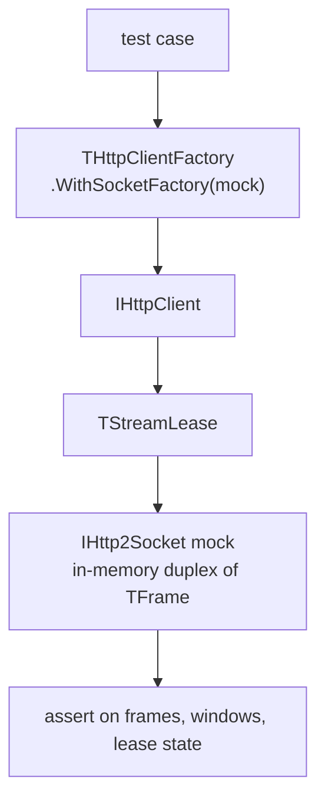
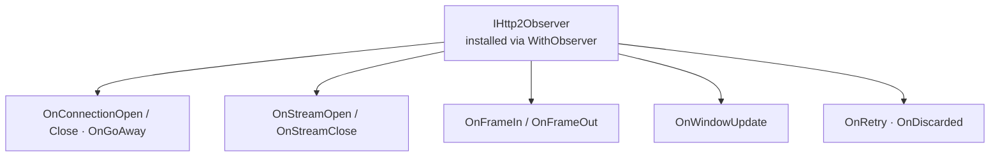

# Testing & Observability

## Test seams

The suite exercises real behaviour without a network by substituting the
transport:

- **`IHttp2Socket` mock** — `test/Http2.MockSocket.pas` is an in-memory
duplex of `TFrame`s. The whole connection loop, HPACK, flow control, and
the lease state machine run against it.
- **`IHttp2SocketFactory`** — the factory's `WithSocketFactory` installs a
  custom transport, which is how the mock is injected in tests and how a
  caller could supply their own TLS stack.
- **Proxy routing** — `IProxySelector` and the proxy environment are pure and
  tested without a socket (`WithProxyEnvironmentLookup` replaces the process
  environment). A scripted loopback server plays an HTTP `CONNECT` proxy, an
  https proxy and a SOCKS5 proxy, and acts as the origin inside the tunnel,
  which exercises TLS inside TLS on 127.0.0.1 only. An opt-in live gate,
  `make validate-proxy`, drives the client through reference proxies in
  `tools/validate/proxy_servers.py` and checks their logs for the route taken;
  with `nghttpd` installed it also runs strict-mode HTTP/2 through each proxy kind.
- **Pure layers** — `THpackCodec`, `TWindow`, `TFrame`/`TFrameHeader`
  serialization, and the header codec are pure enough to test in isolation.
- **`TResponseReader<T>`** — the base reader plus the optional
  `Http2.Readers` JSON/XML readers are tested directly against an
  `IHttpResponse` built from a string.



## Test suite layout

The fpcunit console runner is `test/Http2.TestRunner.pas`; the entry point
is `test/Http2.RunTests.pas`. One test unit per source area:

| Test unit | Area |
|---|---|
| `Http2.Errors.Test` | exception hierarchy and error codes |
| `Http2.Frames.Test` | frame header/payload round-trips |
| `Http2.Headers.Test` | header collection and constants |
| `Http2.Hpack.Test` / `Http2.HpackProps.Test` | HPACK codec + property tests |
| `Http2.FlowControl.Test` | `TWindow` arithmetic |
| `Http2.Tls.Test` | ALPN, policy, certificate checks |
| `Http2.BlockingQueue.Test` | bounded blocking queue |
| `Http2.ConnectionThread.Test` | per-connection thread loop |
| `Http2.ConnectionLifecycle.Test` | create/drain/GOAWAY/close |
| `Http2.Stream.Test` | stream state machine + `THttpBody` |
| `Http2.Client.Test` | client surface, readers, text helpers |
| `Http2.Request.Test` | `THttpRequest` construction |
| `Http2.Redirects.Test` | 3xx rewriting and bounds |
| `Http2.Timeouts.Test` | connect/header/idle deadlines |
| `Http2.Readers.Test` | JSON/XML readers and send helpers |
| `Http2.Concurrency.Test` | caps and backpressure under load |
| `Http2.ProbeOutcome.Test` | `TProbeOutcome` classification |
| `Http2.ClearText.Test` / `Http2.Http1.Test` | h2c and HTTP/1.1 fallback; a declined upgrade and `ctHttp1` send each request once (the scripted peer counts the copies it received) |

Property-style checks (HPACK `Decode(Encode(H)) = H`, window arithmetic,
frame serialization) run alongside the example-based cases. Run with
`make test` or `task test`; the runner exits non-zero on any failure.

## Observability hooks

`IHttp2Observer` (in `src/Http2.Observer.pas`) is installed with
`THttpClientFactory.WithObserver`:

```pascal
type
  IHttp2Observer = interface
    procedure OnConnectionOpen;
    procedure OnConnectionClose(const AMessage: string;
      const ACode: THttp2ErrorCode);
    procedure OnGoAway(const ALastStreamId: LongWord;
      const ACode: THttp2ErrorCode);
    procedure OnStreamOpen(const AStreamId: LongWord);
    procedure OnStreamClose(const AStreamId: LongWord);
    procedure OnFrameIn(const AFrame: TFrame);
    procedure OnFrameOut(const AFrame: TFrame);
    procedure OnWindowUpdate(const AStreamId: LongWord;
      const AIncrement: LongWord);
    procedure OnRetry(const AStreamId: LongWord);
    procedure OnDiscarded(const AFrame: TFrame; const AReason: string);
  end;
```



An observer is passive and must not block: callbacks fire on the connection
thread. Observers are attached per connection as it is opened, so a single
observer instance sees every connection the client creates.

`IHttp2Observer` has no request context. The request-level seam,
`IHttpClientObserver` installed with `WithRequestObserver`, reports attempts
instead of frames; see [request-observability](request-observability.md). The
tests for it use `TRecordingRequestObserver` in `Http2.RequestObserver.Test`, a
sibling of `TRecordingObserver` that records the attempts, the outcomes and the
order of the callbacks.

## Observer adapter tests

`Http2.ObserverAdapters.Test` is the integration test for the request observer
seam. It compiles against the example adapters in `examples/`
(`observer_tracing`, `observer_metrics`, `observer_logging`), which the test
target reaches through `-Fu./examples`, and drives them through the real client
and the scripted peers, so nothing needs a live server.

- **Tracing.** A redirect chain under a caller's span gives sibling child
  spans in one trace; the DECODED request headers the peer captured show
  exactly one `traceparent` per hop, naming that hop's span and replacing a
  value the caller set. Status and error, a stream failure, a retry, an SSE
  reconnect loop and an abandoned response are each asserted from the spans.
- **Metrics.** A scripted SSE stream runs under the injectable clock
  (`SetNowUsHook`): the attempt starts at one instant, a ticker observer moves
  the clock before the request is written, and the peer delivers frames at
  stamped instants. Every derived number is then compared with what the script
  fixes: time to first byte, time to first event, mean inter-event latency, max
  gap, stream duration, event and byte rates and total latency. The per-event
  histogram's bucket counts are compared with the scripted gaps and the
  histogram does not exist while the gate is off. Counters by status, the
  in-flight gauge and the pool gauge (one `PoolStats` snapshot per collection)
  are asserted around held and released responses.
- **Logging.** A frozen clock makes every time in a line 0, so the lines of a
  redirect are compared whole. The retry, abandoned, stream-failure and
  refused-before-send cases check the line, its level and its fields.
- **Composition.** The three adapters are installed together. Each behind a
  forwarding spy that notes its callbacks in one log, the order is start and
  headers in registration order and end in reverse. A tracer registered first
  records a header a later observer injected, and a later observer sees the
  `traceparent` the tracer injected. A WebSocket session against the scripted
  loopback server is observed by all three.

The recording observer in these tests is registered first, so its end callback
runs last and a wait on it means the adapters have finished. The overhead
measurement is not a test: it is `examples/observer_overhead.pas`, run by
`make measure-observer` (see [observer-overhead](../verification/observer-overhead.md)).

## WebSocket tests

`Http2.WebSocket.Test` covers the pure unit: the RFC 6455 section 5.7 frames
byte for byte, the frame parser fed one byte at a time, in random chunks and
whole, every protocol-error rule with its close code, the UTF-8 and close-code
tables, message assembly across fragments, the handshake accept and reject
matrix, request bytes, and the immutable request values.

`Http2.WebSocketClient.Test` runs the client against a scripted loopback
server on a raw socket that checks the handshake bytes, reads masked client
frames and sends unmasked server frames: echo, demand, ping answered before
the callback, both close directions, protocol violations, handshake refusal,
bytes after the upgrade head, concurrent sends, fragmented sends, a large
message, abort, the close and ping timeouts, a raising listener, and a fresh
masking key per frame. Tests wait on events with a bounded timeout and never
sleep to wait for another thread.

The opt-in live gate (`task validate:websocket`) starts
`tools/validate/ws_servers.py` and the proxy servers of `proxy_servers.py`,
runs `Http2.WebSocketLive.Test` over `ws` and `wss`, directly and through an
HTTP `CONNECT` proxy, an `https://` proxy and a SOCKS5 proxy, and then reads
the servers' logs: every client frame carries the mask bit, the handshake
headers are as required, and the close codes and the route are as expected.
`task validate:cleartext` runs a bodyless `GET`, `POST`, `DELETE` and `HEAD`
under `ctUpgrade` and `ctHttp1` against `tools/validate/h1_counter_server.py`,
an HTTP/1.1-only server that logs each request, and checks that each arrived
once. `task validate:websocket:autobahn` runs the Autobahn|Testsuite fuzzing server
(Docker) against `tools/validate/autobahn_client.pas` and summarises its
report; cases 12 and 13 (`permessage-deflate`) are excluded because the client
offers no extension.

## Concurrency tests

`Http2.Concurrency.Test` drives many threads calling `Send` against a slow
streaming mock to prove:

- the per-host (`MaxConnectionsPerHost`) and pool-wide
  (`MaxTotalConnections`) connection caps hold under contention;
- `MaxStreamsPerConnection` and the peer's
  `SETTINGS_MAX_CONCURRENT_STREAMS` bound concurrent requests;
- backpressure throttles the caller instead of buffering without limit.
