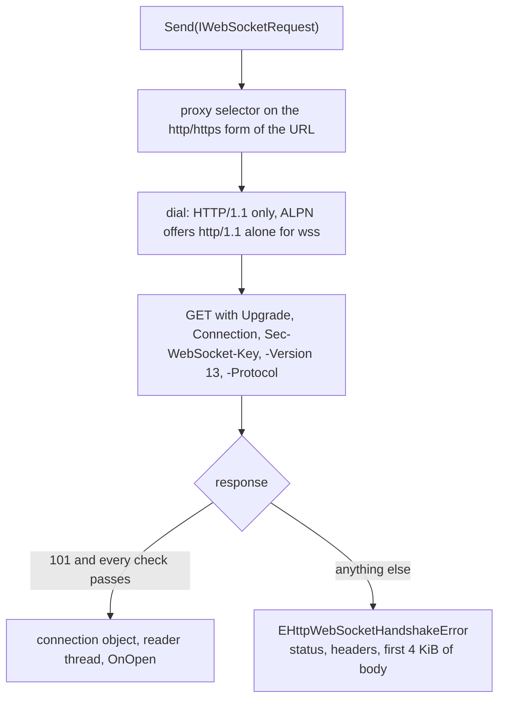
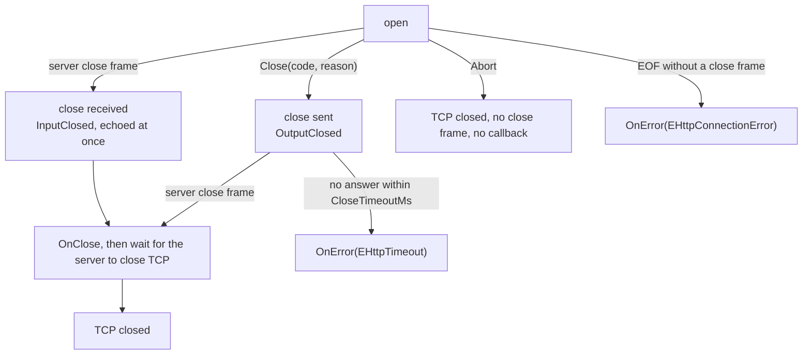

# WebSocket

The client opens WebSocket connections ([RFC 6455](https://www.rfc-editor.org/info/rfc6455/))
to `ws://` and `wss://` URLs and carries the conversation as listener
callbacks and blocking sends. The API follows the JDK 11
`java.net.http.WebSocket`: a listener, demand-driven delivery (`Request(n)`),
a `last` flag on fragments, `Abort`, and the `InputClosed` / `OutputClosed`
flags. The protocol edge cases follow the Go ecosystem, where the standard
library has no WebSocket package and `gorilla/websocket` and
`coder/websocket` are the working references.

```pascal
var
  Socket: IWebSocket;
begin
  Socket := HttpClient.Send(
    TWebSocketRequest.Create('wss://example.com/chat', MyListener)
      .WithSubprotocol('chat'));
  Socket.SendText('hello');
```

## Scope

- RFC 6455 over HTTP/1.1 only. The opening handshake is an HTTP/1.1
  `Upgrade`; RFC 8441 (WebSocket over HTTP/2 with extended `CONNECT`) is not
  implemented, as in Go's `net/http` and the JDK.
- No extension is offered, and any `Sec-WebSocket-Extensions` answer fails the
  handshake. In particular `permessage-deflate` is not supported.
- The units are `Http2.WebSocket` (frame codec, message assembly, handshake
  rules and the public interfaces; it uses only FPC standard units, including
  `sha1` and `base64`, and `Http2.Errors`) and `Http2.WebSocketClient` (the
  connection and the opening handshake). Both are re-exported by `Http2`, and
  `Http2.Client` declares aliases for `IWebSocket`, `IWebSocketListener`,
  `IWebSocketRequest`, `TWebSocketListener` and `TWebSocketRequest`, so a
  program that names only `Http2.Client` can use the API.

## Interfaces

| Type | Role |
| --- | --- |
| `IWebSocketRequest` | immutable request to open a socket; every `WithX` returns a new one |
| `IWebSocketListener` | receives what the server sends |
| `TWebSocketListener` | base class with empty callbacks; descend and override what is needed |
| `IWebSocket` | the open conversation |
| `TWebSocketRequest` | the request implementation: `Create(url, listener)` |

`IHttpClient` has an overload, `Send(const ARequest: IWebSocketRequest):
IWebSocket`. A class that implements `IHttpClient` itself has to add that
method.

### Request

`TWebSocketRequest.Create(url, listener)` takes a `ws`, `wss`, `http` or
`https` URL (`ws` and `http` are cleartext on port 80, `wss` and `https` are
TLS on port 443) and a listener, which is required. A URL fragment, an unknown
scheme or an unusable authority raises `EHttpWebSocketError`.

| Method | Meaning |
| --- | --- |
| `WithConnectTimeoutMs(n)` | bounds the dial and each handshake read; `0` uses the client's connect timeout |
| `WithHeader(name, value)` | adds a request header; names the handshake owns (`Host`, `Upgrade`, `Connection`, `Content-Length`, `Transfer-Encoding`, `Expect`, every `Sec-WebSocket-*`) raise at this call |
| `WithSubprotocol(name)`, `WithSubprotocols(list)` | offered in `Sec-WebSocket-Protocol`; each must be an HTTP token |
| `WithCloseTimeoutMs(n)` | how long to wait for the server's close frame, and for it to close TCP, default `5000` |
| `WithMaxMessageBytes(n)` | bound on one message summed across its fragments, default 16 MiB, `0` for none |
| `WithPingIntervalMs(n)` | when above `0`, a ping is sent after that much silence and a connection silent for twice as long fails with `EHttpTimeout`; default off |
| `WithAutoRequest(b)` | requests one more notification after each delivery, and one at the start |
| `WithContext(o)` | an opaque object the request observer receives as `THttpAttempt.Context` |

### Listener

| Callback | Called when |
| --- | --- |
| `OnOpen(socket)` | the handshake succeeded; the first callback |
| `OnText(socket, text, last)` | a text fragment arrives |
| `OnBytes(socket, data, last)` | a binary fragment arrives |
| `OnPing(socket, data)`, `OnPong(socket, data)` | a ping or pong arrives |
| `OnClose(socket, code, reason)` | the server's close frame arrives |
| `OnError(socket, error)` | the connection fails after the handshake; the error object is freed on return |

A connection that the caller does not `Abort` ends with exactly one of
`OnClose` or `OnError`. `Abort` ends delivery without a further callback.

### Socket

| Member | Meaning |
| --- | --- |
| `Request(n)` | allows `n` more notifications; `n <= 0` raises |
| `SendText(text, last = True)`, `SendBinary(data, last = True)` | send a message, or one fragment of it when `last` is `False` |
| `SendPing(data)`, `SendPong(data)` | at most 125 octets |
| `Close(code = 1000, reason = '')` | begins the closing handshake; reason at most 123 octets |
| `Abort` | closes the connection at once, without a close frame |
| `InputClosed`, `OutputClosed` | whether the server's close frame arrived, and whether ours was sent |
| `Subprotocol`, `Url` | the negotiated subprotocol (`''` when none) and the request URL |

## Opening handshake



The request carries `Host` (with the port unless it is the scheme default; an
IPv6 literal is bracketed), `Upgrade: websocket`, `Connection: Upgrade`, a
fresh `Sec-WebSocket-Key` of 16 random octets, `Sec-WebSocket-Version: 13`,
the subprotocol list when set, then the caller's headers. User information in
the URL is not sent.

The response is accepted when all of these hold:

- the status is `101`;
- `Upgrade` contains the token `websocket` and `Connection` contains the
  token `upgrade`, compared without regard to case;
- `Sec-WebSocket-Accept` equals the base64 of the SHA-1 of the key followed by
  `258EAFA5-E914-47DA-95CA-C5AB0DC85B11`;
- `Sec-WebSocket-Protocol` is absent, or names exactly one subprotocol the
  request offered;
- `Sec-WebSocket-Extensions` is absent.

A failure raises `EHttpWebSocketHandshakeError` carrying the status, the
header lines and up to 4 KiB of the body. Redirects are not followed, and a
`401` or `407` is reported rather than retried. Bytes the server sends after
the `101` head, in the same read, belong to the frame stream and are kept.

The connection to the server is made by a dial that speaks HTTP/1.1 only
(`IHttp1SocketFactory`): for `wss` the ALPN offer is `http/1.1` alone, a server
that selects `h2` is refused, and a server that answers no ALPN is accepted,
since many WebSocket servers lack ALPN. The fallback and cleartext switches of
[fallback](fallback.md) do not apply: a `ws://` URL is allowed under the default
cleartext policy. A socket factory that lacks the dial makes `Send` raise
`EHttpWebSocketError`.

## Frames

The codec follows RFC 6455 section 5. A client frame is always masked with a
fresh 32-bit key drawn from the OpenSSL random generator for each frame; a
generator that fails raises, and nothing falls back to a non-secure source. A
server frame must not be masked.

The reader treats these as protocol errors, answers with the matching close
code and reports `EHttpWebSocketProtocolError` through `OnError`:

| Condition | Close code |
| --- | --- |
| masked server frame, reserved bit set (no extension is negotiated), undefined opcode, fragmented or over-long control frame, length not in its shortest form, 64-bit length with its top bit set, continuation with no message open, new data frame inside an open message, close payload of one octet, close code that is not sent on the wire (`0`-`999`, `1004`-`1006`, `1012`-`2999`, `5000` and above) | `1002` |
| text that is not valid UTF-8, or a close reason that is not | `1007` |
| a message over `MaxMessageBytes`, or a frame header declaring more than 64 MiB | `1009` |

Text is validated incrementally, fragment by fragment, so a bad prefix fails
before the message ends. A character split across fragments is legal: the
bytes of an unfinished character are held back and delivered with the next
fragment, so every `OnText` call receives whole characters. A fragment that is
only part of a character delivers nothing yet.

In this library a `string` holds UTF-8 bytes, and `SendText` checks that the
text is valid UTF-8 before anything is written; invalid text raises
`EHttpWebSocketError`.

## Delivery and demand

One reader thread per socket performs every read and runs every callback, one
at a time, in wire order. A callback may call `Send*`, `Request`, `Close` and
`Abort`.

Delivery follows the JDK's demand rule. Demand starts at zero. Each
`OnText`, `OnBytes`, `OnPing`, `OnPong` and `OnClose` consumes one unit, and
with none left the reader stops, so TCP flow control pushes back on the
server. `OnOpen` needs no demand. Fragments are delivered one by one, each
counting once.

Control frames are answered before they are delivered. A ping is answered
with a pong carrying the same payload before `OnPing` runs, so a slow callback
does not delay the answer, and a close frame is echoed at once, while the
matching callbacks wait for demand. The reader processes one frame at a time,
so a frame that waits for demand also holds back the frames behind it.

`OnClose` costs demand like the other notifications, but it never holds the
connection open: when the server's close frame arrives the reader echoes it,
waits for the server to close TCP (up to `CloseTimeoutMs`), closes the socket,
and only then waits for demand to deliver `OnClose`. A listener that never
requests leaves the reader thread parked with the connection already closed;
`Abort` releases it.

A listener that raises from a callback has the exception passed to `OnError`,
and the socket is aborted.

The reader thread holds a reference to the connection until it ends, so a
socket whose last outside reference is dropped keeps delivering until it is
closed, aborted or fails. When the reader ends, the connection drops its
references to the request and listener and frees its buffers, so a listener
that keeps the socket it was given (the usual JDK pattern) does not form a
cycle that outlives the conversation.

## Sending

`Send*` calls block until the whole frame is written and may be made from any
thread: each frame is written whole under a lock, so concurrent messages
interleave only at frame boundaries. A control frame may therefore fall
between the fragments of a data message, as RFC 6455 section 5.4 allows. A
message sent in fragments must keep one kind: a binary send inside an open
text message raises `EHttpWebSocketError`.

A write that fails or times out aborts the connection, since a partial frame
leaves the stream unusable. A send after the output side is closed raises
`EHttpWebSocketClosedError`.

When reads and writes share one TLS state (every `wss` connection, and a
cleartext connection through an `https://` proxy), the socket is guarded by a
lock, because OpenSSL does not allow `SSL_read` and `SSL_write` on one
connection at the same time. The reader takes the lock only for short polls
of 25 ms and yields to a waiting sender, so a send waits at most one poll. A
plain TCP connection needs no lock and polls every 100 ms; the poll is how
the reader notices `Abort`, the close timeout and the ping interval. The
timers are checked on every pass of the reader, so a server that keeps sending
cannot keep a close timeout from firing.

## Closing



`Close` sends a close frame and returns; it does not wait. `OnClose` runs when
the server's close frame arrives. After both frames have been exchanged the
client waits up to `CloseTimeoutMs` for the server to close TCP, then closes
it. A server close that arrives first is echoed with the same status code (an
empty close payload is echoed empty and reported as `1005`). A second `Close`
does nothing. Status codes `1004`, `1005`, `1006` and `1015`, and codes
outside `1000`-`1003`, `1007`-`1011` and `3000`-`4999`, cannot be sent.

## Routing and pooling

The proxy selector (see [proxy](proxy.md)) is called once, with the URL's `http` or
`https` form (`ws` maps to `http`, `wss` to `https`), so `http_proxy`,
`https_proxy`, `all_proxy` and `no_proxy` apply as for the same HTTP request.
Both `ws` and `wss` go through the tunnel kinds described in [transport](transport.md):
`CONNECT`, `CONNECT` inside TLS to an `https://` proxy, and SOCKS5. Loopback
connects directly.

A WebSocket owns its connection for its whole life. It is not pooled and does
not count against `MaxConnectionsPerHost` or `MaxTotalConnections`, since a
long-lived socket held against those caps would starve ordinary requests.
`IHttpClient.Close` does not close live WebSockets; each is closed or aborted
by its owner.

## Errors

| Situation | Exception | Where |
| --- | --- | --- |
| unusable URL, scheme, header, subprotocol, argument, or a factory that cannot dial HTTP/1.1 | `EHttpWebSocketError` | request construction, `WithX`, `Send`, `Send*` |
| send after the output side closed | `EHttpWebSocketClosedError` | `Send*` |
| handshake refused (status, headers, body kept) | `EHttpWebSocketHandshakeError` | `Send` |
| the server broke RFC 6455 (carries the close code) | `EHttpWebSocketProtocolError` | `OnError` |
| dial, TLS or proxy failure; EOF without a close frame | `EHttpConnectionError` | `Send`, `OnError` |
| connect, close or ping timeout | `EHttpTimeout` | `Send`, `OnError` |

All derive from `EHttpError`.

## Reference implementations

| Reference | What it settles here |
| --- | --- |
| JDK 11 `java.net.http.WebSocket`, `WebSocket.Builder`, `WebSocket.Listener`, `WebSocketHandshakeException` | the API shape: a listener, `request(n)` with nothing delivered until requested, the `last` flag, `abort`, `isInputClosed` / `isOutputClosed`, rejection of handshake-owned headers, automatic pong, payload and reason limits, no redirects, the failed response carried by the handshake exception |
| Go `gorilla/websocket` (`Dialer`, read limit, default ping and close handlers, `ErrBadHandshake`) | handshake validation, what a failed handshake reports, pong and close echoed by default, proxy chosen from the environment, a read limit as a safety net |
| Go `coder/websocket` | the closing handshake with a bounded wait, a default read limit, UTF-8 enforcement on text |
| RFC 6455 sections 4, 5, 7, 8 and 10 | the normative handshake, framing, close codes, error handling and masking security |

> [!info] mORMot2 as a reference
> The pinned checkout contains a complete WebSocket stack, and the library
> already depends on mORMot2 for TLS (`mormot.lib.openssl11`). `Http2.WebSocket`
> and `Http2.WebSocketClient` take **no** dependency on it: they are
> self-contained units that mirror its designs. Names below are from the
> checkout recorded in [toolchain](../verification/toolchain.md).

| mORMot2 piece | What it shows | Mirrored here by |
| --- | --- | --- |
| `TWebSocketFrameOpCode` and `TWebSocketFrame` (`mormot.net.ws.core`) | opcodes as an enumeration with the reserved values named, so an undefined opcode is a distinct case | the opcode check in the frame parser |
| `FRAME_LEN_MASK` and `ProcessMask` (`mormot.net.ws.core`) | the mask bit as a constant, and a masking loop that XORs a word at a time with a byte tail | `WsApplyMask`, which keeps the key phase across chunks |
| `ComputeChallenge` (`mormot.net.ws.core`) | the accept value as the SHA-1 of the key and the protocol GUID | `WsComputeAccept` |
| `THttpClientWebSockets` and the handshake in `mormot.net.ws.client` | a client handshake that checks the accept challenge (`Invalid HTTP Upgrade Accept Challenge`) and reads `Sec-WebSocket-Extensions` and `Sec-WebSocket-Protocol` from the answer | `WsCheckResponse` |
| `HeartbeatDelay` (`TWebSocketProcessSettings`) | keep-alive pings sent after a quiet period, off by default on the client | `WithPingIntervalMs` |

Behaviour of the reference code that shapes the design:

- mORMot2 layers its own sub-protocols on top of RFC 6455 (for example
  `synopsejson`) and binds the connection to its server framework, so it is
  read for its frame handling and handshake, while the client API above
  follows the JDK.
- The reference draws the masking key of each outgoing frame from
  `NetRandom32`, so a key per frame is the model here as well; the key comes
  from OpenSSL's generator and a failing generator raises.
- The reference treats a masking key of zero as "not masked" when it reads a
  frame header. RFC 6455 allows a zero key, so the mask bit alone decides
  here.

## Observing a session

A client built with `WithRequestObserver` sees a WebSocket as one attempt of
kind `akWebSocket` (see [request-observability](request-observability.md)):

- `IWebSocketRequest.WithContext` attaches the context the observer receives.
- The attempt starts before the dial, and the observer may inject handshake
  headers through `Headers`; the headers the handshake owns are refused with
  `EHttpWebSocketError`, as `WithHeader` refuses them.
- `OnResponseHeaders` fires at the `101`; a refused handshake ends the attempt
  with the error and the refusal's status.
- The attempt ends once: after the close handshake, on `Abort`, on a failure,
  or (only for a connection that never started) on release. `ClosedBy`,
  `CloseCode` and `CloseReason` say how. The end does not wait for the
  listener's `OnClose`.
- Counters (`MessagesIn`, `MessagesOut`, `BytesIn`, `BytesOut`, first, last and
  gap times) are always kept; an observer that implements
  `IHttpMessageObserver` and asks for `mkWs*` kinds gets one `OnMessage` per
  text, binary, ping, pong and close message, in each direction.

Stamps are taken where the reader thread reads the socket. Delivery is demand
driven, so a reader that has no demand is not reading: without
`WithAutoRequest` and with no outstanding `Request(n)`, the stamp of a message
includes the time the consumer took to ask for the one before it. With
`WithAutoRequest` the reader keeps reading while the listener runs and the
stamps are the server's. Delivery itself is unchanged.

## Known limits

- HTTP/1.1 only; RFC 8441 is not implemented.
- No extension, including `permessage-deflate`.
- No automatic reconnection; reopening is the caller's decision.
- No transport-observer events per frame (`IHttp2Observer` sees nothing of a
  WebSocket). The request observer covers a session: see
  [Observing a session](#observing-a-session).
- Total handshake time is bounded per step (the dial, then each response
  read), not as one budget.
- The Autobahn|Testsuite fuzzing client run needs Docker; see
  [testing-observability](testing-observability.md).

## Example

A listener that echoes, asks for more input after each message and ends the
conversation when the server closes:

```pascal
type
  TEchoListener = class(TWebSocketListener)
  public
    procedure OnOpen(const ASocket: IWebSocket); override;
    procedure OnText(const ASocket: IWebSocket; const AText: string;
      const ALast: Boolean); override;
  end;

procedure TEchoListener.OnOpen(const ASocket: IWebSocket);
begin
  ASocket.Request(1);
end;

procedure TEchoListener.OnText(const ASocket: IWebSocket; const AText: string;
  const ALast: Boolean);
begin
  if ALast then
    ASocket.SendText(AText);
  ASocket.Request(1);
end;
```

Opening it through the proxy environment variables, with a close timeout:

```pascal
var
  Client: IHttpClient;
  Socket: IWebSocket;
  Listener: IWebSocketListener;
begin
  Client := THttpClientFactory.Create.WithProxyEnvironmentVars.Build;
  Listener := TEchoListener.Create;
  Socket := Client.Send(
    TWebSocketRequest.Create('wss://example.com/echo', Listener)
      .WithCloseTimeoutMs(2000));
  Socket.SendText('hello');
  Socket.Close(1000, 'done');
end;
```
