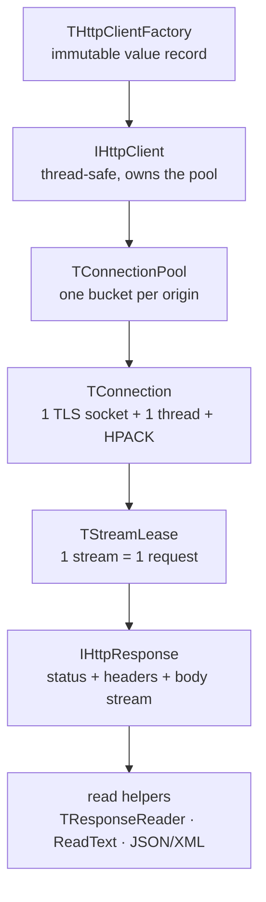

# HTTP/2 Client

An Object Pascal HTTP/2 client.

Target: **Free Pascal 3.2.4** (`{$mode delphi}`), advanced records +
interfaces. Language claims are verified against FPC 3.2.4 — see
[fpc-runtime](design/fpc-runtime.md) and the re-runnable probes under
[`reference/fpc-verified/`](reference/fpc-verified/README.md).

## Design model

A **lease is one HTTP/2 stream, not one TCP connection**. A single
connection multiplexes many concurrent streams. `MaxConnectionsPerHost` caps
concurrent **TCP connections to one authority** and `MaxTotalConnections` caps
them **across all authorities**; `MaxStreamsPerConnection` (and the peer's
`SETTINGS_MAX_CONCURRENT_STREAMS`) caps **concurrent requests**. The rest of the design depends on this model. Details in [architecture](design/architecture.md).



## Document map

| Note | Covers |
| --- | --- |
| [architecture](design/architecture.md) | resolved multiplexing model, component diagram, unit layout and naming |
| [fpc-runtime](design/fpc-runtime.md) | language mode, compiler directives, verified FPC facts, ARC/memory model |
| [client-api](design/client-api.md) | `THttpClientFactory` + `IHttpClient`, defaults, lease acquisition |
| [messages](design/messages.md) | `IHttpResponse`, `THttpRequest`, `IHttpHeaders`, header constants, streaming |
| [protocol](design/protocol.md) | frame layer, HPACK, flow control |
| [transport](design/transport.md) | threading and queues, connection lifecycle, TLS/ALPN |
| [mtls](design/mtls.md) | mutual TLS: `IClientIdentity`, the PEM and PKCS#12 loaders, `WithClientIdentity`, and the `EHttpTlsClientAuthError` a rejection raises |
| [proxy](design/proxy.md) | proxy routing per request: fixed proxy, `http_proxy` / `https_proxy` / `no_proxy`, `WithNoProxy`, `IProxySelector` |
| [websocket](design/websocket.md) | WebSocket client (RFC 6455): `IWebSocketRequest`, `IWebSocketListener`, `IWebSocket`, demand-driven delivery, close handshake, `ws`/`wss` through every proxy kind |
| [fallback](design/fallback.md) | cleartext h2c (prior knowledge and upgrade) and HTTP/1.1 fallback |
| [errors-redirects](design/errors-redirects.md) | exception hierarchy, timeouts, cancellation, redirects |
| [server-sent-events](design/server-sent-events.md) | Server-Sent Events: event-stream parser, SSE source, reconnect/resume, body-read timeout |
| [testing-observability](design/testing-observability.md) | test seams, `fpcunit`, `IHttp2Observer` |
| [request-observability](design/request-observability.md) | request-level observer: trace-context injection, attempt lifecycle, wire-stamped timing, SSE and WebSocket coverage, pool statistics, and the tracing, metrics and logging adapters in `examples/` |
| [open-questions](design/open-questions.md) | single source of truth for unresolved decisions |

## Verification

| Note | Covers |
| --- | --- |
| [validation](verification/validation.md) | the validation record: what is gate, what is oracle, the commands, and the results |
| [toolchain](verification/toolchain.md) | locked, externally verified tool and library revisions |
| [observer-overhead](verification/observer-overhead.md) | how the observer overhead is measured on loopback, and the results table |

## Quick start

```pascal
uses
  {$IFDEF UNIX}cthreads,{$ENDIF}          // threads on Unix need this first
  SysUtils, Classes, Http2.Client;

var
  Client: IHttpClient;
  Response: IHttpResponse;
begin
  Client := THttpClientFactory.Create
    .WithMaxConnectionsPerHost(2)
    .WithMaxTotalConnections(8)
    .WithMaxStreamsPerConnection(50)
    .WithFollowRedirects(False)
    .Build;
  Response := Client.Send(
    THttpRequest.Create(hmGet, 'https://api.example/things'));
  // Response.StatusCode / Response.Headers available now; read Response.Body to Eof.
end;
```

See [client-api](design/client-api.md) for the full factory surface and [messages](design/messages.md) for
request/response construction. On this machine the binary must also find
OpenSSL at runtime:

```sh
OPENSSL_LIBPATH=/opt/homebrew/opt/openssl@3/lib ./myprogram
```

## Examples

`examples/` holds eleven small programs and three observer adapter units — see `examples/README.md`:

| Program | Shows |
|---|---|
| `basic_get` | factory, `Send`, reading the body |
| `post_text` | `WithTextBody`, a plain-text request body |
| `json_request` | `Http2.Readers` JSON send + read |
| `xml_request` | `Http2.Readers` XML send + read |
| `sse_stream` | `Http2.Sse` event-stream reader |
| `websocket_echo` | `TWebSocketRequest` + a listener: open, request demand, send, close |
| `mtls_get` | `WithClientCertificateFiles`: a GET or `wss` session with a client certificate, `EHttpTlsClientAuthError` on a rejection |
| `proxy_env` | `WithProxyEnvironmentVars` + `WithNoProxy`: routing by `http_proxy` / `https_proxy` / `all_proxy` / `no_proxy` |
| `threaded_get` | one shared `IHttpClient` driven by many threads |
| `observer_all` | the tracing, metrics and logging adapters (`observer_tracing`, `observer_metrics`, `observer_logging`) installed together on a request, an SSE stream and a WebSocket |
| `observer_overhead` | what the observers cost on a loopback request (`make measure-observer`) |

```sh
make examples     # or: task examples  ->  bin/<program>
```
